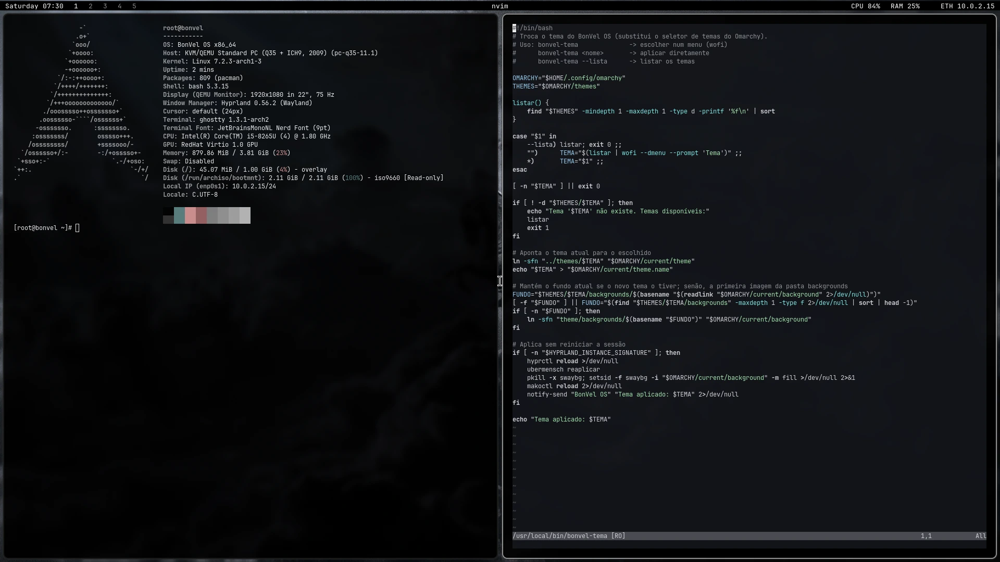
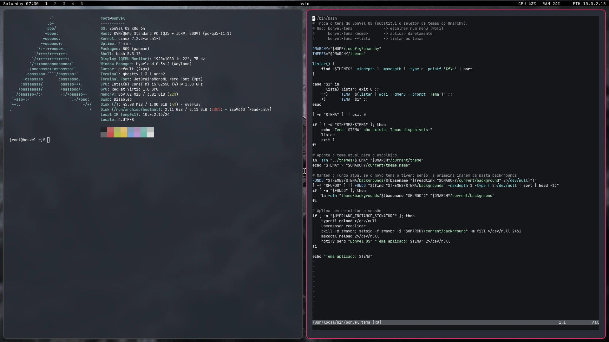
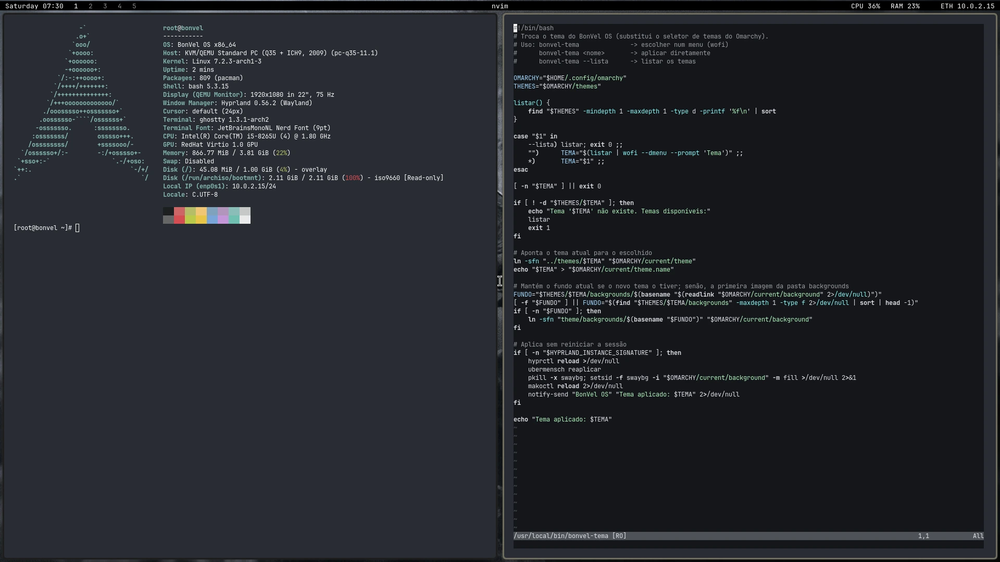
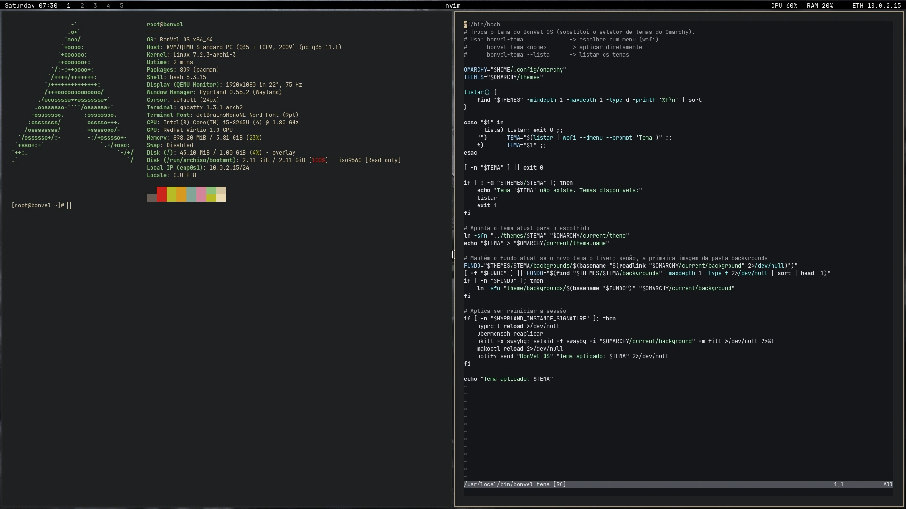
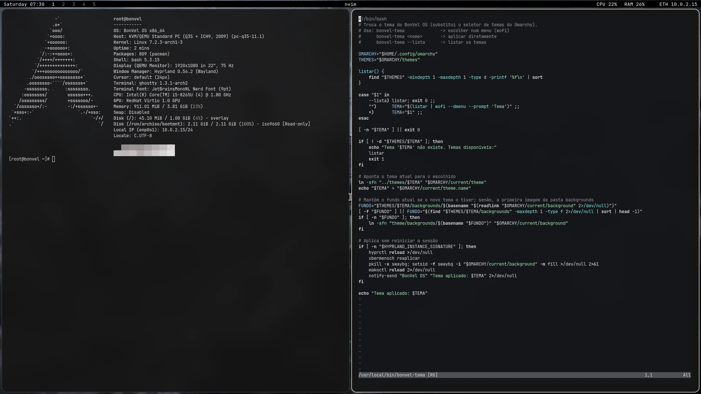
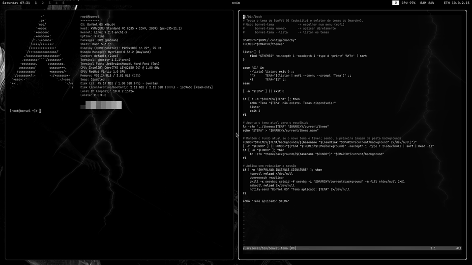
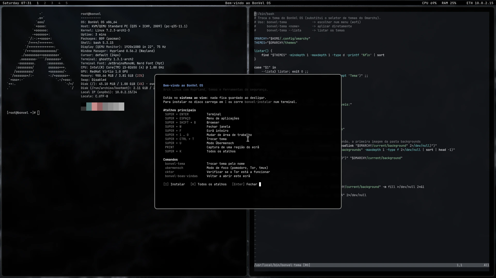

# BonVel Linux

[Português](README.md) | [English](README.en.md)

An Arch Linux distribution built with [archiso](https://wiki.archlinux.org/title/Archiso).
It boots straight into a preconfigured Hyprland desktop with themes, ready-to-use shortcuts, and security tools.



<sub>snow_black theme by [ankur311sudo](https://github.com/ankur311sudo/snow_black).</sub>

## Creators

Created by **Hussein** ([BON333](https://github.com/BON333)) and **Kleyton** ([Mente-MiIionaria](https://github.com/Mente-MiIionaria)).

## What's included

- **Hyprland** with waybar, Ghostty, foot, wofi, and mako preconfigured
- **Themes** switchable with `SUPER + CTRL + T` or `bonvel-tema`: snow_black, LainOm, greek-noir, gruvu, and latchdark (community-created; see [credits](#theme-credits))
- **Übermensch Mode** (`SUPER + U`): black-and-white display, terminal lightning effects, muted notifications, Nietzsche quotes, a pomodoro timer, and a Tor/tmux work session
- **Screen shaders** for Hyprland (CRT, matrix, night vision, color-blindness filters, and more), from [Aether](https://github.com/bjarneo/aether)
- **BlackArch security tools**: metasploit, hydra, sqlmap, john, aircrack-ng, wireshark-cli, nmap
- **BIOS and UEFI boot**, with a custom GRUB menu
- **Installer** `bonvel-instalar` and a welcome screen with the main shortcuts

## Screenshots

### Themes

| LainOm by [YuriRomano02](https://github.com/YuriRomano02/LainOm) | greek-noir by [HANCORE](https://github.com/HANCORE-linux/omarchy-greek-noir-theme) |
|---|---|
|  |  |
| **gruvu** by [ankur311sudo](https://github.com/ankur311sudo/gruvu) | **latchdark** by [atif-1402](https://github.com/atif-1402/omarchy-latchdark-theme) |
|  |  |

### Übermensch Mode



### Welcome screen

On first boot, a summary of the shortcuts appears. In the live system, press `I` to open the installer.



Screenshots are generated with `liveCDt/tools/capturas.py`, which boots the ISO in QEMU and captures them automatically.

## Getting started

On Arch Linux with `archiso` installed:

```bash
git clone https://github.com/BON333/BonVel-linux
cd BonVel-linux/liveCDt
tools/build.sh       # builds the ISO in ~/iso_out
tools/runSystem.sh   # tries the ISO in QEMU
```

To install to disk, run `bonvel-instalar` from the live system (network setup, `archinstall`, and BonVel in one step). After rebooting, log in with your user account on tty1.

## Documentation

Shortcuts, BonVel commands, details about Übermensch Mode, and the project structure are documented in [liveCDt/README.en.md](liveCDt/README.en.md).

## Related projects

- [BON333/ubermensch](https://github.com/BON333/ubermensch) — Übermensch Mode for installation on Omarchy or another Hyprland setup

## Issues and suggestions

Open an [issue](https://github.com/BON333/BonVel-linux/issues).

## Theme credits

These themes were created by members of the Omarchy community and are included in BonVel with credit:

| Theme | Creator | Repository |
|---|---|---|
| snow_black | ankur311sudo | [ankur311sudo/snow_black](https://github.com/ankur311sudo/snow_black) |
| LainOm | YuriRomano02 | [YuriRomano02/LainOm](https://github.com/YuriRomano02/LainOm) |
| greek-noir | HANCORE | [HANCORE-linux/omarchy-greek-noir-theme](https://github.com/HANCORE-linux/omarchy-greek-noir-theme) |
| gruvu | ankur311sudo | [ankur311sudo/gruvu](https://github.com/ankur311sudo/gruvu) |
| latchdark | atif-1402 | [atif-1402/omarchy-latchdark-theme](https://github.com/atif-1402/omarchy-latchdark-theme) |

## License

[MIT](LICENSE). The screen shaders are from [Aether](https://github.com/bjarneo/aether), also licensed under MIT.
