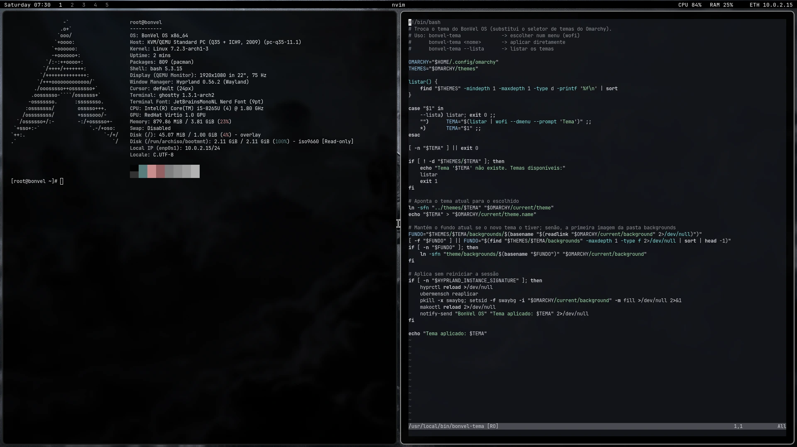
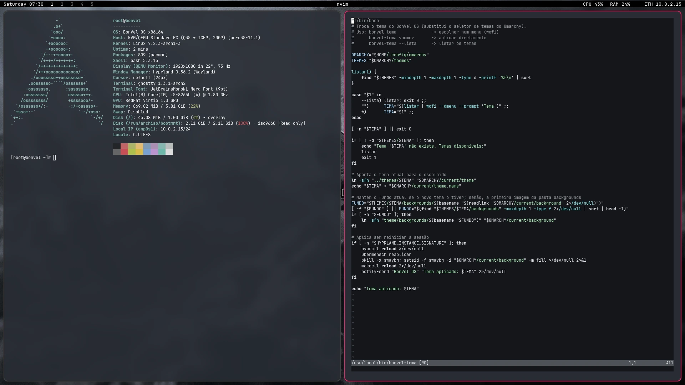
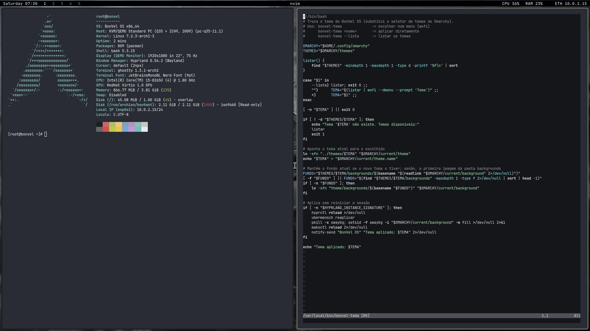
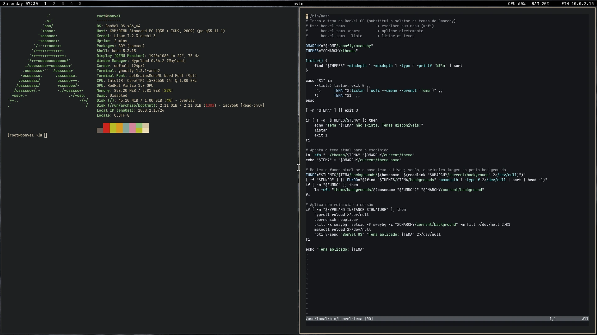
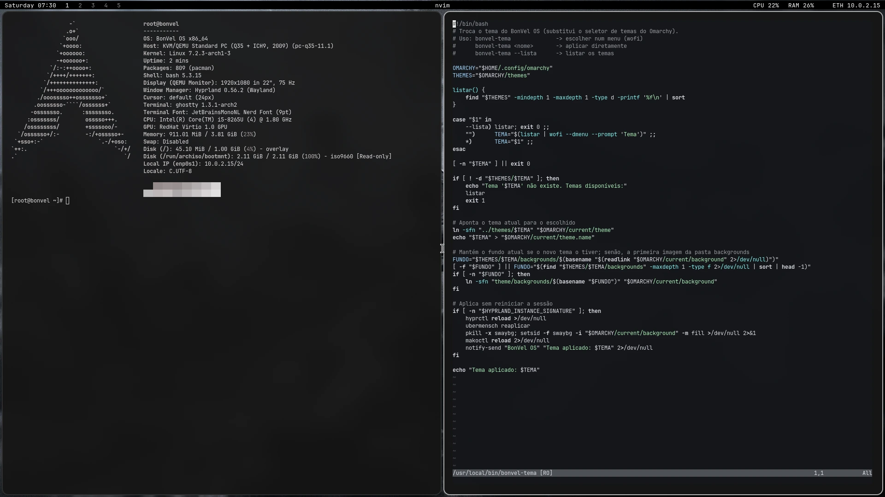
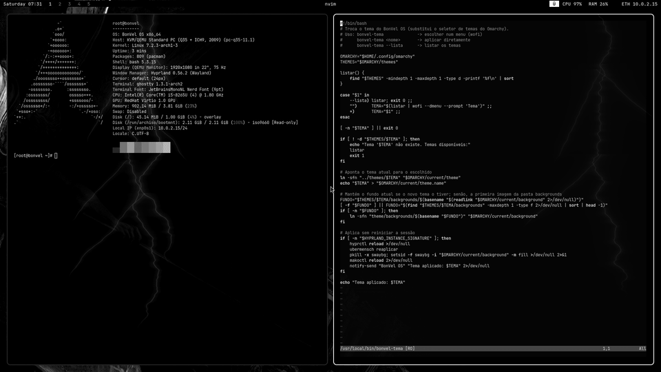
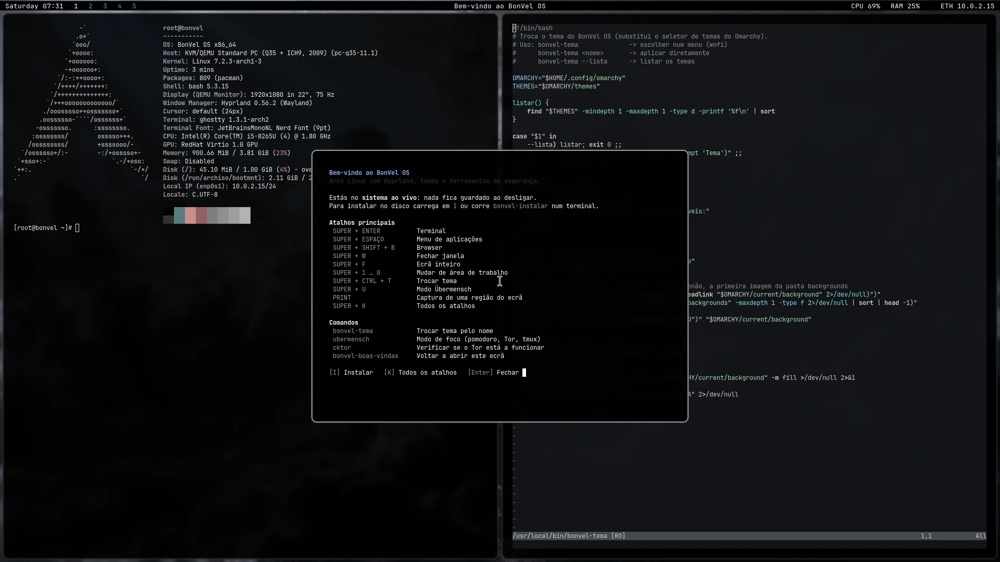

# BonVel Linux

Distribuição Linux baseada em Arch Linux, feita com [archiso](https://wiki.archlinux.org/title/Archiso).
Arranca direto num ambiente Hyprland já configurado, com temas, atalhos prontos e ferramentas de segurança incluídas.



## Criadores

Criado por **Hussein** ([BON333](https://github.com/BON333)) e **Kleyton** ([Mente-MiIionaria](https://github.com/Mente-MiIionaria)).

## O que traz

- **Hyprland** com waybar, Ghostty, foot, wofi e mako já configurados
- **Temas** que se trocam com `SUPER + CTRL + T` ou `bonvel-tema`: snow_black, LainOm, greek-noir, gruvu e latchdark
- **Modo Übermensch** (`SUPER + U`): ecrã a preto e branco, relâmpagos no terminal, notificações silenciadas, frases de Nietzsche, pomodoro e sessão de trabalho com Tor e tmux
- **Shaders do ecrã** para o Hyprland (CRT, matrix, visão noturna, filtros para daltonismo e outros), vindos do [Aether](https://github.com/bjarneo/aether)
- **Ferramentas de segurança** do BlackArch: metasploit, hydra, sqlmap, john, aircrack-ng, wireshark-cli, nmap
- **Arranque em BIOS e UEFI**, com menu GRUB próprio
- **Instalador** `bonvel-instalar` e um ecrã de boas-vindas com os atalhos principais

## Imagens

### Temas

| LainOm | greek-noir |
|---|---|
|  |  |
| **gruvu** | **latchdark** |
|  |  |

### Modo Übermensch



### Ecrã de boas-vindas

No primeiro arranque aparece um resumo dos atalhos. No sistema ao vivo, a tecla `I` abre o instalador.



As imagens são geradas com `liveCDt/tools/capturas.py`, que arranca a ISO no QEMU e tira as capturas sozinho.

## Começar

Num Arch Linux com `archiso` instalado:

```bash
git clone https://github.com/BON333/BonVel-linux
cd BonVel-linux/liveCDt
tools/build.sh       # constrói a ISO em ~/iso_out
tools/runSystem.sh   # experimenta a ISO no QEMU
```

Para instalar no disco, a partir do sistema ao vivo: corre `bonvel-instalar` (rede, `archinstall` e BonVel num só passo) e, depois de reiniciar, entra com o teu utilizador no tty1.

## Documentação

Os atalhos, os comandos do BonVel, o modo Übermensch em detalhe e a estrutura do projeto estão em [liveCDt/README.md](liveCDt/README.md).

## Projetos relacionados

- [BON333/ubermensch](https://github.com/BON333/ubermensch) — o modo Übermensch para instalar no Omarchy ou noutro Hyprland

## Problemas e sugestões

Abre uma [issue](https://github.com/BON333/BonVel-linux/issues).

## Licença

[MIT](LICENSE). Os shaders do ecrã vêm do [Aether](https://github.com/bjarneo/aether), também com licença MIT.
